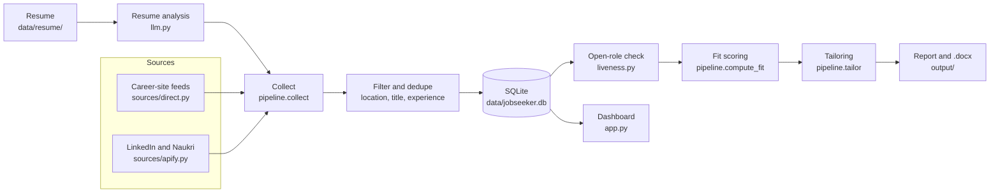

# JobSeeker

JobSeeker is a personal AI recruiter. Twice a day it searches the career sites of your target companies, plus LinkedIn and Naukri. It confirms each role is still open and scores how well your resume fits it. For the strongest matches, it writes a tailored resume that only uses facts already in your resume.

It runs on your own machine. Your resume, API keys, job database and reports stay local and are never committed.

## What it does

| Step | What happens |
|---|---|
| Resume analysis | Once per resume version: your top 5 target job titles, core strengths and skill gaps |
| Search | Your target companies' own career sites, plus LinkedIn and Naukri (through Apify) for those companies and the wider market |
| Filter | Keeps roles in your cities (default Bengaluru, Gurugram and Pune) that match your title and experience level |
| Open-role check | Confirms each role is still live. Closed roles are hidden; roles it can't confirm are marked "unconfirmed" |
| Fit score | 0-100, computed from evidence in your resume, not a number the model picks |
| Buckets | High 80-100, Medium 60-79, Stretch 40-59, below 40 counted only |
| Tailoring | High and Medium roles get a tailored `.docx` resume. Stretch roles are tailored on request |
| Report | A Markdown report per run, plus a Streamlit dashboard |

## Architecture



A run (`pipeline.run`) goes through these steps in order. A source that fails is reported in the run summary and never stops the run.

### Modules

| File | Responsibility |
|---|---|
| `jobseeker/__main__.py` | Command line: run once, check open roles, tailor one role, choose locations |
| `jobseeker/pipeline.py` | Runs a full job search: collect, filter, store, check, score, tailor, report |
| `jobseeker/config.py` | Default settings, city aliases, and the career-site feed for each company (`FEEDS`) |
| `jobseeker/sources/base.py` | Shared `Job` shape and the title, location and experience filters |
| `jobseeker/sources/direct.py` | One fetcher per career-site platform |
| `jobseeker/sources/apify.py` | LinkedIn and Naukri searches through Apify actors |
| `jobseeker/liveness.py` | Checks whether each stored role is still open |
| `jobseeker/llm.py` | OpenAI prompts for resume analysis, fit scoring and tailoring, with strict truth rules |
| `jobseeker/resume.py` | Reads the newest resume (`.docx`, `.pdf`, `.txt` or `.md`) and hashes it |
| `jobseeker/render.py` | Turns a tailored Markdown resume into a `.docx` file |
| `jobseeker/db.py` | SQLite schema and helpers. Each role is stored once, so it is scored and tailored only once |
| `app.py` | Streamlit dashboard |
| `scripts/install_schedule.sh` | Installs a macOS launchd job that runs at 09:00 and 21:00 |

### Career-site feeds

Each company in `FEEDS` maps to a fetcher by platform type. Companies without a feed are searched by name on LinkedIn and Naukri.

| Platform type | Companies |
|---|---|
| Workday job API | Salesforce, Wells Fargo, Capital One, BlackRock, Bank of America, Vanguard, Merck, Shell, Kraft Heinz, Citibank, Morgan Stanley, Maersk, The Standard |
| Greenhouse board API | Stripe, Databricks, Deepwatch |
| Sitemap and job pages | Standard Chartered, Nestle, ANZ Bank, Under Armour, Cargill |
| Site-specific | Google, Microsoft, Apple, Atlassian, Juspay, HSBC, Goldman Sachs, Deloitte (South Asia and USI sites) |
| LinkedIn and Naukri only | Walmart |

Every fetcher returns `Job` objects in your configured cities, capped at `max_results_per_company` per run.

> **Responsible use:** the Google, Microsoft, HSBC, Goldman Sachs and Deloitte USI feeds read pages or APIs that those sites' robots.txt asks automated tools not to use. They are included for personal, low-volume job searching. Check each site's terms before you enable them, and remove any feed you don't want from `FEEDS` in `jobseeker/config.py`. Sites can change or block these endpoints at any time; a broken feed shows up as a source error in the run summary.

### How fit is scored

1. The model lists each requirement in the job description, marks it must-have or nice-to-have, and quotes the resume text that supports it.
2. `evidence_in_resume` checks each quote: at least 80% of its words must appear in your resume, or the requirement counts as missing.
3. `compute_fit` calculates the score: 70% weighted requirement coverage (must-haves count 3x), 15% seniority fit and 15% domain fit. Roles outside your field are capped at 39.

### How a role is confirmed open

A role listed by its source during the current run is open. Any other stored role is checked against its live posting:

| Source | Closed when |
|---|---|
| Workday, Greenhouse, Microsoft, HSBC | The job API returns 404 or 410, or Workday says applications are closed |
| Google, Apple | The job page falls back to a search page or has no job data |
| Sitemap sites, Deloitte | The job link redirects away from the job page or to an error page |
| Atlassian, Juspay, Goldman Sachs | The role is missing from the full listing |
| LinkedIn, Naukri | The page says the role has expired, or it hasn't appeared in any search for 14 days |

A check that fails or is ambiguous never closes a role; it stays "unconfirmed".

### Truthful tailoring

The tailoring prompt may only rephrase and reorder facts already in your resume. After generation, JobSeeker also flags:

- numbers that are not in your resume
- job-description terms that reached the resume without being in the original

Both appear under "Check before sending" in the role's `_notes.md`. Requirements the resume can't support are listed as gaps instead of being added. True details missing from your resume can go in `data/verified_facts.md`, which tailoring may use.

## Setup

Requires Python 3.10 or later. The schedule script needs macOS.

```bash
git clone <this repository>
cd JobSeeker
python3 -m venv .venv
.venv/bin/pip install -r requirements.txt
cp .env.example .env
```

Then fill in `.env`:

| Variable | Needed for |
|---|---|
| `OPENAI_API_KEY` | Resume analysis, fit scoring and tailoring |
| `OPENAI_MODEL` | Model name, default `gpt-4o` |
| `APIFY_TOKEN` | LinkedIn and Naukri. Optional: without it, only career sites are searched |

Put your resume in `data/resume/`. The newest file there is used, and changing it triggers a new resume analysis.

## Usage

```bash
.venv/bin/streamlit run app.py
```

This opens the dashboard. The first time, it asks which cities you want to work in.

```bash
.venv/bin/python -m jobseeker
```

This runs one full search now.

```bash
.venv/bin/python -m jobseeker --check
```

This rechecks that every stored role is still open.

```bash
.venv/bin/python -m jobseeker --tailor JOB_ID
```

This tailors your resume for one role, for example a Stretch role.

```bash
.venv/bin/python -m jobseeker --setup
```

This changes your cities from the command line.

```bash
scripts/install_schedule.sh
```

This installs the twice-daily schedule on macOS.

### Dashboard

| Tab | Shows |
|---|---|
| Open positions | Open roles per target company, scored or not, with links to each job posting. Filter to career sites only or pick one company |
| High, Medium, Stretch | Scored roles with fit score, matched and missing requirements, and the tailored resume to download. Mark roles applied or dismiss them |
| Resume analysis | Target roles, strengths and gaps. Upload a new resume here |
| Settings | Cities, remote roles, years of experience, and the target company list |

**Run now** runs a full search. **Check roles are open** rechecks every stored role.

### Customising

- **Companies:** add or remove them in the dashboard's Settings tab. A new company without a feed is searched on LinkedIn and Naukri.
- **Career-site feed:** add an entry to `FEEDS` in `jobseeker/config.py`. For a Workday site, set `tenant`, `dc` and `site` from its `myworkdayjobs.com` URL. For Greenhouse, set `board`.
- **Limits:** `data/settings.json` controls `max_results_per_company`, `max_jobs_to_score` (150 per run) and `max_tailored_per_run` (15 per run). These cap OpenAI and Apify spend.

## Output

| Path | Contents |
|---|---|
| `output/report_<date>.md` | Buckets, open positions by company, companies with no openings, and source problems |
| `output/tailored/*.docx` | Tailored resumes ready to send |
| `output/tailored/*_notes.md` | Keyword coverage, changes made, fabrication flags and gaps |
| `logs/run.log` | Output from scheduled runs |

`data/`, `output/`, `logs/` and `.env` are git-ignored.

## Costs

- **OpenAI:** scoring and tailoring use your OpenAI key. Roles that fail to score, for example when credits run out, are retried on the next run.
- **Apify:** LinkedIn and Naukri searches cost about $0.22 per run. At two runs a day, that is more than Apify's $5 monthly free credit.

## Tests

```bash
.venv/bin/python -m pytest
```

The tests cover the filters, fit scoring, fabrication checks, feed parsers and open-role checks. They don't call the network.
